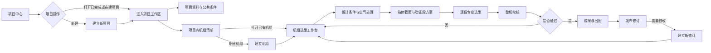

# 组合式空调机组选型软件全流程架构重构方案 V2.0（评审稿）

## 0. 文档定位

本文只定义产品架构、业务流程、页面信息架构、数据归属、模块接口、状态规则和实施边界，不包含代码实现。

本文用于评审下一版软件整体方向。评审通过前，现行权威规格仍为《组合式空调机组选型软件技术规格书 V1.5》；现有项目数据、已确认的功能段规则和专业模块不得因本次重构丢失或要求用户重新录入。

本次重构解决四个问题：

1. 工程师进入软件后能立刻知道项目处于哪个阶段、下一步做什么；
2. 一个参数只在正确位置录入一次，下游自动继承，并能看出来源；
3. 选型、校核、出图、修改和版本追溯形成闭环；
4. 页面只显示当前任务需要的信息，减少按钮、表格和重复字段堆叠。

---

## 1. 架构结论

软件采用“一个工程主流程、三个业务层级、两条计算链、一个统一数据底座”的结构。

### 1.1 三个业务层级

| 业务层级 | 使用人 | 解决的问题 | 边界 |
|---|---|---|---|
| 项目中心 | 项目工程师、技术支持 | 项目查询、新建、打开、归档和项目级管理 | 只管理项目，不直接管理项目内机组 |
| 项目工作区 | 项目工程师、选型工程师 | 维护当前项目资料、查看机组清单、新建机组、修改已完成机组和管理项目成果 | 必须先进入一个具体项目 |
| 机组选型工作台 | 选型工程师 | 当前项目内某台机组的设计条件、截面、功能段、专业选型、校核和出图 | 必须从项目工作区进入 |

产品与规则维护中心是独立的后台能力，不属于项目业务层级，只向有维护权限的人员开放。

数据库维护、规则维护和产品导入不再混入日常机组选型页面。普通工程师在专业选型时只看到产品候选、数据版本和来源。

### 1.2 两条链

| 链 | 内容 | 主要输出 |
|---|---|---|
| 空气处理计算链 | 室外、回风、混风、冷却、加热、加湿、送风等空气状态变化 | 各状态点、能力需求、风量和含湿量 |
| 物理功能段链 | 新回风、混风、过滤、盘管、风机、均流、送排风等箱体实际排列 | 尺寸、阻力、检修关系、接口、图纸和 BOM |

两条链通过稳定的功能段 ID 和空气状态点 ID 关联。空气处理顺序变化时，不允许直接删除已经录入的物理段资料；系统应先显示受影响对象，再由工程师确认调整。

### 1.3 一个统一数据底座

数据按以下层级组织：

```text
Project 项目
├─ ProjectCondition 项目公共条件
├─ Unit 机组 1..n
│  ├─ UnitDesignCondition 机组设计条件
│  ├─ AirStateChain 空气处理计算链
│  ├─ CabinetScheme 箱体截面和安装限制
│  ├─ SegmentChain 物理功能段链
│  │  └─ SegmentInstance 功能段实例 1..n
│  │     ├─ 输入、计算、选型和结构结果
│  │     ├─ 检修、正负压和上下游关系
│  │     └─ 图形、接口、BOM 和规则结果
│  ├─ WholeUnitResult 整机汇总结果
│  ├─ DrawingPackage 图纸成果包
│  └─ Revision 修订记录
└─ AuditTrail 操作与数据来源记录
```

项目、机组、功能段、计算结果和图纸都使用稳定 ID。名称和编号允许修改，不能作为关联主键。

---

## 2. 工程师端到端主流程



### 2.1 工程阶段

| 阶段 | 工程师要完成的事 | 阶段完成条件 | 允许返回 |
|---|---|---|---|
| 1 项目中心 | 查询、新建、打开或归档项目 | 已选定要进入的项目 | 是 |
| 2 项目建立 | 项目资料、地点、室内外和冷热水公共条件 | 必填项目字段完整 | 是 |
| 3 项目内机组管理 | 查看已有机组，选择修改已有机组或新建机组 | 已选择当前机组 | 是 |
| 4 建立机组 | 机组身份、用途、安装型式、风量和核心能力需求 | 能建立独立机组对象 | 是 |
| 5 设计条件 | 确定各工况、风量关系、机外余压和能力需求 | 所需工况都有来源 | 是 |
| 6 截面选型 | 先校核盘管、过滤器等控制风速，再确定截面 | 至少一个截面方案通过硬性规则 | 是 |
| 7 功能段方案 | 建立空气处理链和物理段链，确认组合关系 | 每个需求都有承载功能段 | 是 |
| 8 专业选型 | 逐段完成计算、产品选择、结构和检修配置 | 启用段达到所需选型等级 | 是 |
| 9 整机校核 | 校核尺寸、风速、阻力、压力区、检修、接口和冲突 | 无禁止项，警告已确认 | 是 |
| 10 成果输出 | 生成选型报告、参数表、图纸、BOM 和接口清单 | 成果引用同一资料快照 | 是 |
| 11 发布与修改 | 发布修订；后续修改从已发布版本复制新修订 | 旧成果保持可追溯 | 是 |

工程师可以直接跳到任一已开放阶段查看资料。跨阶段修改后，系统只把受影响的后续结果标为“待重算”或“待复核”，不清空无关数据。

### 2.2 状态不使用模糊百分比代替工程结论

每台机组显示以下状态之一：

`草稿 → 条件完整 → 方案已建立 → 选型进行中 → 待整机校核 → 有警告 → 已通过 → 已发布 → 已归档`

另外单独显示：

- 缺失项数量；
- 禁止项数量；
- 警告数量；
- 待重算段数；
- 待复核段数；
- 当前修订号和数据版本。

“已保存”只表示数据已保存，不表示选型正确；“已通过”必须来自当前数据快照的整机校核。

---

## 3. 页面与导航架构

### 3.1 页面层级

```text
项目中心
├─ 项目查询与管理
├─ 新建项目
├─ 项目归档
└─ 打开具体项目
   └─ 项目工作区
      ├─ 项目资料与公共条件
      ├─ 项目内机组清单
      │  ├─ 新建机组
      │  └─ 打开或修改已有机组
      │     └─ 机组选型工作台
      └─ 项目成果

产品与规则维护中心（独立后台入口，有权限时显示）
```

“新建项目”从项目中心发起；“新建机组”只能从已进入的项目工作区发起。项目中心不得出现“借用项目”，也不得出现针对某台机组的新建、修改、复制、删除或出图按钮。

### 3.2 全局导航原则

顶部只放：

- 项目 / 机组面包屑；
- 当前修订与状态；
- 保存；
- 整机校核；
- 成果输出；
- 更多操作。

导入、复制、归档、数据维护、恢复、调试等低频操作放入“更多操作”或维护中心。顶部不得同时铺开十多个按钮。

### 3.3 项目中心

项目中心默认显示项目表格，支持名称、编号、客户、地点、负责人和状态搜索。页面上方只保留“新建项目”、搜索和归档项目入口。

项目行显示：项目编号、名称、客户、负责人、项目状态、机组数量摘要和最近修改时间。项目中心可以显示机组数量作为项目摘要，但不能展开机组清单或操作机组。点击项目只进入该项目的项目工作区，不直接打开某一台机组。

项目中心提供以下项目级操作：

- **查询**：按项目资料和状态查找项目；
- **新建**：建立空白项目并进入项目工作区；
- **归档**：将已结束项目移入归档区，归档项目默认只读，可恢复；
- **打开**：进入所选项目的项目工作区。

如果需要复用已有机组，应先进入目标项目，再在目标项目的机组清单中执行“借用机组”。借用时从其他项目选择一个已完成机组，系统在目标项目内生成新的机组 ID，并保留来源项目、来源机组和来源修订记录；后续修改不影响来源机组。

### 3.4 项目工作区

只有进入具体项目后才显示项目工作区。项目工作区分为三个区域：

1. 项目摘要：名称、编号、客户、地点、负责人、公共工况版本；
2. 机组清单：机组编号、用途、风量、外形、状态、修订、问题数；
3. 项目成果：本项目已发布的机组成果和缺失情况。

项目公共条件使用独立页签编辑。修改公共条件时，先显示会影响哪些机组，再确认传播。已经由机组覆盖的字段保留覆盖值。

机组清单及其全部操作都在项目工作区内完成：

- 新建机组；
- 打开在建机组继续选型；
- 打开已完成机组查看；
- 对已完成机组建立新修订后修改；
- 在本项目内复制相似机组；
- 从其他项目借用已完成机组，并在本项目生成独立副本；
- 查看机组校核状态和成果状态。

打开机组后进入当前项目内部的机组选型工作台。退出工作台时返回同一项目的机组清单，不返回项目中心。

### 3.5 建立机组只用两步

第一步“机组身份”：

- 设备编号、客户位号、数量；
- 普通机组 / 净化机组；
- 卧式 / 立式 / 热回收等产品型式；
- 落地 / 吊顶，室内 / 室外；
- 气流方向、检修侧和左右式。

第二步“核心条件”：

- 送风、新风、回风、排风及二次回风；
- 机外余压；
- 冷热量、加湿、再热等需求；
- 设计工况来源和项目继承状态。

提交后进入工作台的“设计条件”阶段。截面、段序和具体产品不放在机组建立向导中。

---

## 4. 机组选型工作台

### 4.1 工作台采用任务阶段导航

顶部阶段条固定为：

`设计条件 | 空气处理 | 箱体截面 | 功能段方案 | 专业选型 | 整机校核 | 成果出图`

每个阶段只显示三种标记：未完成、存在问题、已完成。点击标记可查看缺失原因。

### 4.2 稳定的三栏布局

| 区域 | 固定职责 | 何时显示 |
|---|---|---|
| 左栏 | 项目机组树或当前阶段任务目录 | 始终显示，可收起 |
| 中央 | 当前阶段的主要表单、方案画布或结果 | 始终显示 |
| 右栏 | 选中对象属性、字段解释、问题与影响 | 有选中对象时显示，可收起 |

功能段库只在“功能段方案”阶段出现；产品候选只在“专业选型”阶段出现；问题清单只在需要时展开。不同任务不同时堆在一个页面。

### 4.3 功能段方案阶段

中央区域上方显示空气处理链，下方显示物理功能段链。物理段按真实气流方向排列。

功能段卡片只显示：名称、段长、关键型号或规格、状态、主要问题。详细字段在右侧属性区编辑。

支持：

- 点击添加、拖入、复制、停用、删除和前后移动；
- 建立复合功能段，但内部子段仍有独立 ID 和专业结果；
- 显示检修方向、正负压区、可为前后段检修、可提供均风等关系；
- 冲突时在相邻段之间显示具体原因和建议动作。

### 4.4 专业选型阶段

左侧按段序列出需要选型的功能段。中央显示当前段的七个连续步骤：

`输入 → 计算 → 候选比较 → 选定结果 → 结构配置 → 校核 → 图纸/BOM`

没有自动算法的功能段仍使用相同数据结构，允许人工录入选型结果和来源，但必须明确显示“人工选型”，不能展示伪造的自动推荐。

过滤器和盘管由各自专业模块计算，整机工作台只传入统一参数并接收选定结果快照。风机及后续专业模块采用同一接口，不在工作台内复制专业算法。

### 4.5 字段解释必须与字段同屏

每个工程字段提供四类解释：

1. **用途**：这个字段决定什么；
2. **关联**：修改后影响哪些计算、功能段或图纸；
3. **示例**：给出一组符合工程语境的例子；
4. **选项说明**：每个选项分别代表什么，何时使用。

示例：

> **检修需求** 说明该功能段需要从哪个方向接近内部部件。选择“段前”会检查前方是否有可进入空间；选择“侧向”会检查检修侧门和抽出空间。例如框架式 F8 过滤器选择“段前”，导轨式过滤器选择“侧向”。

解释放在右侧帮助区或字段旁信息按钮，不长期占用主表单宽度。系统自动值显示来源，例如“继承项目条件”“过滤器模块计算”“人工覆盖”。

---

## 5. 计算、选型与规则架构

### 5.1 统一专业模块接口

每个专业模块对整机工作台提供同一种逻辑契约：

| 接口 | 内容 |
|---|---|
| 输入快照 | 风量、截面、工况、目标能力、上下游条件、产品库版本 |
| 计算结果 | 中间计算值、单位、公式版本、适用条件 |
| 候选结果 | 候选产品、排序依据、满足项和不满足项 |
| 选定结果 | 型号、数量、性能、结构尺寸、阻力和选定人 |
| 校核结果 | 通过、警告、禁止及可执行建议 |
| 图形接口 | 外形、连接口、检修口和定位基准 |
| BOM 接口 | 物料、数量、规格、选件和来源 |

### 5.2 先定截面的原则

截面推荐必须同时考虑过滤器和盘管的控制风速。流程为：

1. 生成可制造的箱体截面候选；
2. 用控制风速和已知部件尺寸初筛；
3. 反算过滤器组合、盘管迎面面积和数量；
4. 专业模块复核性能与布置；
5. 任何硬性条件不通过时，该截面不能标为可选。

挡水板配置阈值按已确认值 2.75 m/s 管理，但应作为有版本号的规则项，不写死在页面说明中。

### 5.3 规则结果必须可执行

| 级别 | 含义 | 系统行为 |
|---|---|---|
| 提示 | 优化建议，不影响选型正确性 | 可继续 |
| 警告 | 可能影响成本、维护或性能 | 工程师确认原因后可继续 |
| 禁止 | 违反硬性边界、无法制造或无法可靠工作 | 阻止发布和正式出图 |

每条问题必须说明：对象、原因、当前值、限值、影响和建议修改入口。例如“送风口速度 12.8 m/s，超过硬性上限 12 m/s；建议增大风口或调整出风面”。

### 5.4 影响分析与局部重算

修改数据时建立依赖关系：

- 项目室外工况变化：影响引用该工况且未覆盖的机组；
- 机组风量变化：影响截面、风速、过滤器、盘管、风机、阻力和图纸；
- 截面变化：影响所有依赖宽高的功能段和接口定位；
- 功能段顺序变化：影响空气状态、正负压、检修、均风和图纸；
- 单个产品型号变化：只影响本段、相邻接口、整机阻力、尺寸、BOM 和成果。

系统保留原结果供比较，但标为“已失效”，工程师完成重算或人工复核后再形成新快照。

---

## 6. 成果、出图和修订管理

### 6.1 项目内成果管理

每台机组的成果在所属项目工作区内统一管理。项目中心不提供机组出图入口：

- 选型计算书；
- 技术参数表；
- 机组外形和功能段方案图；
- DXF/DWG 交付接口；
- PDF；
- BOM；
- 报价接口；
- 电控和点表接口；
- 选型依据和数据版本清单。

所有成果必须引用同一 `DrawingPackage` / `SelectionSnapshot`，避免报告、图纸和 BOM 来自不同修改状态。

### 6.2 出图前置条件

正式成果必须满足：

1. 当前机组无禁止项；
2. 所有启用功能段达到规定选型等级；
3. 图形所需尺寸、接口和定位完整；
4. 警告已由工程师确认；
5. 当前数据快照已经整机复核；
6. 图纸标题、修订号和复核人完整。

草图预览可以随时生成，但必须标识“未校核”或“资料不完整”。

### 6.3 修改维护采用修订制

机组一旦发布，原修订只读。修改时执行“基于当前修订创建新修订”，例如 A → B。新修订记录：

- 修改原因；
- 发起人和时间；
- 变更字段与功能段；
- 受影响的计算、图纸和 BOM；
- 重算和复核状态；
- 新旧成果差异。

项目复制用于新项目复用；机组复制用于同一项目的相似设备；修订用于同一机组方案变更，三者不能混为一个“复制”按钮。

---

## 7. 产品、规则和图形维护中心

维护中心采用独立入口，并按权限显示四个工作区：

| 工作区 | 维护内容 | 发布要求 |
|---|---|---|
| 产品数据 | 过滤器、盘管、风机及附件型号和性能 | 导入校验、差异预览、版本发布 |
| 工程规则 | 风速、尺寸、阻力、检修和组合规则 | 测试用例、适用范围、批准人 |
| 方案模板 | 常用功能段链和项目默认条件 | 模板说明、适用产品、版本 |
| 图形与 BOM | 图块、接口符号、物料映射 | 预览、尺寸基准、版本 |

维护过程采用“草稿 → 校验 → 审核 → 发布 → 停用”。选型项目保存所用版本的引用和关键数据快照；数据库更新后，旧项目不自动改变结果。

---

## 8. 视觉与交互规范

### 8.1 页面简洁的具体标准

- 一个页面只保留一个主要任务和一个主按钮；
- 常用操作直接显示，低频操作收入菜单；
- 主表单默认只展开必填和关键字段，高级字段按专业分组折叠；
- 同一字段不得在顶部摘要、中央表单和右侧属性中同时可编辑；
- 空结果、未启用功能和未来能力不占据大面积页面；
- 表格行操作在选中或悬停时出现；
- 工程单位紧贴数值，不能只写在表头深处；
- 颜色只表达选中、成功、警告和禁止，不作为装饰大面积混用。

### 8.2 建议视觉基线

| 项目 | 建议 |
|---|---|
| 页面底色 | 浅灰白，工作卡片使用白色 |
| 主色 | 深蓝，用于导航和标题 |
| 强调色 | 青绿色，用于当前选中和主操作 |
| 警告 / 禁止 | 琥珀 / 红色，只用于状态和问题 |
| 字体 | 中文无衬线，正文 14px，表单标签 13px，标题 18–24px |
| 间距 | 8px 基础网格，卡片内边距 16–24px |
| 圆角 | 6–8px，避免过度卡片化 |
| 密度 | 默认工程密度，可切换紧凑模式 |

1366×768 下，当前阶段主操作、关键参数、当前段和问题状态必须在首屏可见；1920×1080 下不应出现大片无意义空白。左右栏均可收起，中央画布优先获得空间。

### 8.3 防止页面杂乱的验收检查

- 顶部直接显示的主操作不超过 6 个；
- 同屏一级页签不超过 7 个；
- 一个表单分组建议不超过 8 个可见字段；
- 同一时刻只出现一个主色按钮；
- 功能段卡片默认不超过 5 行信息；
- 任何禁止项都能一次点击定位到具体字段；
- 工程师不需要在三个页面之间来回查同一个输入值。

---

## 9. 数据继承与已确认知识保护

### 9.1 继承顺序

数据按以下顺序取值：

`公司默认 / 规则库 → 项目公共条件 → 机组覆盖 → 功能段输入 → 专业选型结果`

每个值保存：值、单位、来源、来源版本、录入/计算人、更新时间和覆盖状态。

### 9.2 已确认规则的处理

已确认的新回风、送排风、过滤器、盘管、风机、检修、开洞边界、正负压和附件规则，进入“工程规则库待发布集”。它们在迁移后自动继承到对应功能段，不要求用户再次逐项确认。

仍未确认的内容标为“待确认”，不能自动变成硬性规则。发生规则冲突时保留来源和最新确认记录，由架构/专业评审决定，不由页面代码自行猜测。

### 9.3 旧项目迁移

迁移顺序：

1. 只读加载旧项目；
2. 生成新结构的迁移副本；
3. 显示字段映射、缺失项和无法识别项；
4. 工程师确认后保存为新版本；
5. 原始文件和原成果不覆盖。

旧项目中的人工型号、段长、接口、确认记录和来源字段必须保留。没有对应新字段的内容进入“原始扩展数据”，不能静默丢弃。

---

## 10. 架构模块边界

| 模块 | 负责 | 不负责 |
|---|---|---|
| 01 过滤器选型 | 过滤器组合、数量、规格和专业结果 | 项目流程、整机段序、检修段总规划 |
| 02 盘管选型 | 盘管型号和专业性能 | 项目管理、整机图纸和跨段检修协调 |
| 03 整机选型工作台 | 项目、机组、两条链、段实例、整机规则、成果编排 | 复制过滤器、盘管等专业算法 |
| 后续风机模块 | 亿利达及后续品牌的风机曲线和选型 | 整机阻力来源管理和项目修订 |
| 成果服务 | 同一几何模型生成预览、CAD、PDF 和接口数据 | 修改专业选型结果 |
| 维护中心 | 产品、规则、模板和图块版本 | 直接改写已发布项目成果 |

模块之间只交换带版本的输入和结果快照。专业模块可以独立测试和升级，升级后旧项目仍能读取原选型快照。

---

## 11. 分阶段实施建议

架构评审通过后，再由软件工程师和 UI 工程师拆解，开发人员实施。

### 阶段 A：流程和数据骨架

- 固化项目、机组、功能段、修订和快照模型；
- 建立七阶段工作台导航和状态机；
- 完成旧数据迁移规则；
- 保留现有人工选型能力。

验收重点：旧项目可打开，已确认字段不丢失，工程师能从项目走到机组和功能段。

### 阶段 B：专业模块接入

- 过滤器和盘管使用统一专业接口；
- 建立风机模块接口和亿利达数据边界；
- 建立依赖图、局部重算和规则结果。

验收重点：输入只录一次，专业结果能回到整机，改风量后准确显示受影响对象。

### 阶段 C：图纸与工程成果

- 建立统一几何模型；
- 生成预览、PDF、DXF、参数表和 BOM；
- 建立出图门槛和修订差异。

验收重点：同一快照的各项成果一致，未通过机组不能发布正式图纸。

### 阶段 D：维护和自动选型

- 产品与规则维护中心；
- 数据审核和版本发布；
- L2 辅助推荐和 L3 自动组合优化；
- 权限、服务端数据库和多人协作。

验收重点：数据升级可追踪，自动推荐说明依据，人工覆盖保留原因。

---

## 12. 后续角色交付边界

| 角色 | 下一步交付物 |
|---|---|
| 项目工程师 | 确认范围、优先级、阶段和验收口径 |
| AHU 架构工程师 | 功能段边界、组合规则、检修关系和专业硬性条件 |
| 软件架构师 | 数据模型、模块接口、状态机、迁移与任务拆分 |
| UI 工程师 | 页面线框、交互说明、视觉规范和响应式状态 |
| 前端工程师 | 根据批准的页面和接口实施，不自行改业务规则 |
| 后端工程师 | 正式持久化、权限、审计、文件和版本服务 |
| 数据管理员 | 产品库、规则库、模板和图块的发布流程 |
| 验收工程师 | 端到端场景、专业规则、数据迁移和成果一致性验收 |

---

## 13. 本轮建议确认的架构决策

以下内容建议作为下一版基线：

1. 项目中心只负责项目查询、新建、打开和归档，不设置借用项目，也不直接管理任何机组；
2. 进入具体项目后才显示项目资料、机组清单、项目成果和机组选型工作台；
3. 机组建立最多两步，截面和段序移到工作台；
4. 工作台采用七阶段任务流，工程师可返回修改；
5. 空气处理计算链和物理功能段链分离并关联；
6. 专业模块使用统一输入/结果快照接口，整机工作台不复制算法；
7. 已发布机组只读，修改必须建立新修订；
8. 报告、图纸和 BOM 使用同一成果快照；
9. 已确认规则迁移到规则库，不让用户重新录入；
10. 字段帮助统一说明用途、关联、示例和选项含义；
11. 页面按当前任务显示内容，数据库和低频操作退出日常选型主界面。

本文通过评审后，应升级总体技术规格，并分别形成数据契约、页面线框、专业模块接口、迁移方案和验收用例；在这些内容批准前不进入代码重构。
