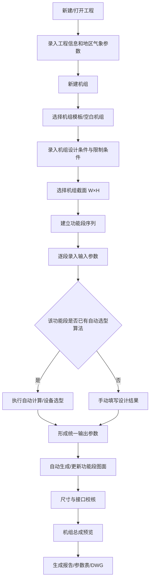

# 组合式空调机组选型软件——现有界面改造需求说明（Codex 执行稿）

> 用途：基于现有选型软件继续修改，不建议推倒重做。本文根据现有项目管理、机组创建、机组截面、功能段编排界面截图整理，作为 Codex 阅读现有代码、定位窗体/控件/数据模型并实施改造的需求基线。

## 1. 改造目标

现有软件已经具备较完整的工程管理、机组创建、截面选择、功能段组合、DWG 出图等框架。此次改造的核心不是重写 UI，而是在现有软件基础上建立一套更规范、可持续扩展的组合式空调机组选型流程：

1. 保留现有工程管理和机组组合操作习惯；
2. 优化机组创建流程，把项目级参数、机组级参数、设计工况、限制条件分层；
3. 统一各功能段的“输入参数 → 自动计算结果 → 图面 → 输出参数”结构；
4. 第一阶段重点保证机组图面、尺寸、功能段参数及 DWG/报告输出；
5. 暂未实现自动选型的功能段允许手动输入，后续逐块接入计算模块；
6. 所有参数从第一版开始建立统一字段 ID、单位、来源和数据映射，避免以后自动选型时重构数据结构。

---

## 2. 当前软件界面结构

### 2.1 工程/机组管理主界面

现有主界面采用典型桌面工程软件结构。

**顶部主菜单：**
- 工程
- 机组
- 非标件附件
- 机组报价
- 工程报价
- 报告
- DWG图纸
- 模板管理
- 工程管理
- 用户管理
- 报价数据管理
- 工具
- 关于

**左侧工程树：**
- 未完成工程
- 收藏的工程
- 已完成工程
- 工程下按照用户/年份/月/项目分层显示

**右侧/中部工作区：**
- 工程基本信息
- 工程查询
- 用户信息
- 新建工程弹窗
- 机组模板选择等业务窗体

### 2.2 新建工程界面

截图中现有字段包括：

**基本信息**
- 项目登录号
- 创建日期
- 业务员
- 设计师
- 使用地区
- 使用城市
- 工程名称（必填）
- 客户名称
- 工程地址
- 联系方式

**气象信息**
- 海拔高度
- 夏季大气压
- 冬季大气压
- 夏季新风：干球、湿球、相对湿度、焓值、含湿量
- 夏季回风：同上
- 冬季新风：同上
- 冬季回风：同上

现有逻辑已经可以根据地区/城市带出部分气象参数。此能力保留。

### 2.3 机组模板选择界面

现有流程：工程 → 新建/添加机组 → 机组模板选择。

当前界面包括：
- 机组方案号
- 客户编号
- 机组类型
  - 组合式空调机组（不包含分流段）
  - 组合式空调机组（分流段）
  - 转轮（热管）空调机组
  - 板式空调机组
- 机组结构
- 板式机芯等关联选择
- 个人模板
- 公共模板
- 下一步
- 取消

**改造要求：**模板只能作为“快速建立初始段序”的入口，不能限制后续自由增加、删除、前移、后移功能段。

### 2.4 机组截面/箱体尺寸选择界面

现有界面包含：

**基础参数**
- 送风风量
- 框架类型
- 使用季节
- 数量
- 使用地区/城市
- 海拔高度
- 夏季/冬季新风、回风状态点
- 夏季/冬季大气压

**截面选择矩阵**
- 横轴 W(M)
- 纵轴 H(M)
- 根据风量和截面积计算迎面风速
- 通过颜色区分风速区间
- 标识常规机型

现有颜色逻辑示例：
- 绿色：v ≤ 2.7 m/s
- 黄色：2.7 < v ≤ 3.0 m/s
- 橙色：3.0 < v ≤ 3.5 m/s
- 红色：v > 3.55 m/s

**其他信息**
- 基础高度
- 水盘材质
- 护板内板材质
- 护板外板材质
- 机组位置
- 接管方向
- 护板内/外板厚度

**改造要求：**保留矩阵选截面的方式，但截面选择结果应形成明确的数据对象，例如 `section_width_mm`、`section_height_mm`、`face_velocity_mps`、`section_area_m2`，供后续盘管、过滤器、风机等功能段直接调用。

### 2.5 功能段编排/机组组合主界面

现有界面是后续重点改造区域。

**顶部 Ribbon 功能段库可见内容包括：**
- 混合段
- 新风段
- 回风段
- 消声段
- 中间段
- 出风段
- 初效过滤
- 中效过滤
- 高效过滤
- 静电除尘
- 外挂过滤
- 盘管组合
- 冷水盘管
- 热水盘管
- 钢管盘管
- 电加热器
- 直接蒸发
- 直接蒸发组合
- 加湿段
- 普通风机
- 控流段/相关风机段
- 热回收段
- 一体式热管
- 转轮
- 板换
- 消音控制/电气控制等

**左侧操作区：**
- 新增
- 修改
- 保存
- 批量选型
- 一键配置
- 一键计算
- 工况/段序相关选项
- 前移
- 后移
- 修改
- 删除
- 选型报告
- 送审图纸

**中部画布：**
- 机组侧视/剖面组合图
- 显示气流方向
- 各功能段编号
- 各段长度尺寸
- 总体高度/宽度等尺寸
- 功能段内部示意符号

**右侧：**
- 当前机组树
- 风量
- 功能段组合摘要
- 功能段列表
- 功能段参数页签
- 标准段长等字段

现有示例段序：
1. 混合段
2. 电加热段
3. 初中效过滤段
4. 直接蒸发段
5. 电加热段
6. 送风机段
7. 箱体段（列表中预留）

---

## 3. 新版总体业务流程



---

## 4. 机组创建界面改造

建议把现有“模板选择 → 截面 → 功能段”的分散输入，整理为向导式流程，但仍允许用户随时返回修改。

### Step 1：机组基本信息

字段建议：
- 机组方案号
- 客户编号
- 机组名称/位号
- 机组数量
- 机组类型
- 使用季节：夏季 / 冬季 / 冬夏季
- 安装位置：室内 / 室外
- 气流方向：左进右出 / 右进左出 / 自定义
- 接管方向：左式 / 右式 / 自定义
- 电源：默认 AC380V/3Ph/50Hz，可修改

### Step 2：核心设计输入

必须允许录入：
- 送风量 m³/h
- 新风量 m³/h
- 新风比 %（与新风量联动，二选一主输入）
- 回风量 m³/h
- 排风量 m³/h
- 机外余压 Pa
- 夏季室外干球/湿球或 RH
- 夏季室内干球/湿球或 RH
- 冬季室外干球/湿球或 RH
- 冬季室内干球/湿球或 RH
- 冷水供/回水温度 ℃
- 热水供/回水温度 ℃
- 冷媒类型及蒸发/冷凝工况（直膨机组启用）

### Step 3：限制条件

新增独立“限制条件”区域：
- 最大机组宽度 mm
- 最大机组高度 mm
- 最大机组总长度 mm
- 最大单段长度 mm
- 检修空间限制
- 运输分段最大尺寸
- 运输分段最大重量（预留）
- 电源限制
- 噪声限制 dB(A)
- 风速限制 m/s
- 客户指定品牌/材料/特殊要求

**原则：**限制条件不一定参与第一阶段自动计算，但必须保存到机组对象，并在后续选型/校核时可调用。

### Step 4：截面选择

继续使用现有 W×H 矩阵，但增加：
- 推荐截面突出显示；
- 当前选中截面的宽、高、面积、风速实时显示；
- 超过最大宽/高限制的截面自动禁用或警示；
- 支持手动输入非标准截面；
- 确认后写入机组主数据，不要仅保存在 UI 控件状态中。

### Step 5：模板/段序

用户可以：
- 从公共模板创建；
- 从个人模板创建；
- 创建空白机组；
- 从已有机组复制；
- 创建后自由修改段序。

---

## 5. 功能段统一数据模型【核心】

所有功能段必须遵循同一接口思想：

```text
FunctionSection
├─ identity      功能段身份
├─ geometry      尺寸/位置
├─ input         用户输入
├─ calculation   自动计算中间值
├─ output        对外输出结果
├─ interfaces    水/电/冷媒/排水等接口
├─ drawing       图面资源与绘图参数
├─ validation    校核结果
└─ metadata      数据来源/版本/人工修改标识
```

建议基础字段：

```yaml
section_id: UUID
section_type: cooling_coil
section_name: 冷水盘管段
sequence: 4
length_mm: 700
width_mm: 3200
height_mm: 1770
input: {}
calculation: {}
output: {}
interfaces: []
drawing:
  symbol_id: coil_chilled_water_v1
  view: side
  scale_mode: fit
validation:
  status: pass
  messages: []
metadata:
  calculation_mode: manual|auto|mixed
  manually_overridden: false
```

### 统一规则

1. **输入参数**：用户/工程条件给定，原则上不由本段随意改写；
2. **计算参数**：程序内部中间量；
3. **输出参数**：报告、图纸、下游功能段真正调用的数据；
4. **人工覆盖**：任何自动计算结果允许有权限的用户修改，但必须记录 `manually_overridden=true`；
5. **单位统一**：数据库存储采用统一工程单位，UI 可以转换显示；
6. **字段 ID 不使用中文标题作为唯一键**，中文仅作为显示名称。

---

## 6. 功能段编辑界面标准

双击功能段或点击“修改”，统一打开功能段编辑器。

建议页签：

### 6.1 基本参数
- 功能段名称
- 段长
- 箱体宽/高（默认继承机组截面）
- 是否非标
- 备注

### 6.2 输入参数
根据功能段类型动态加载。

例如冷水盘管：
- 入口空气状态
- 目标出口空气状态/目标冷量
- 风量
- 冷水供水温度
- 冷水回水温度
- 允许空气侧阻力
- 允许水侧阻力
- 迎面风速限制

### 6.3 计算/选型结果
例如：
- 冷量 kW
- 显热量 kW
- 潜热量 kW
- 排数
- 片距
- 迎面风速
- 水流量
- 水阻
- 空气阻力
- 出风状态

### 6.4 接口参数
统一维护：
- 接口类型
- 数量
- 规格
- DN
- 方位
- 高度/定位尺寸
- 备注

接口类型至少预留：
- 冷水
- 热水
- 冷媒液管
- 冷媒气管
- 蒸汽
- 冷凝水
- 加湿给水
- 排水
- 电源
- 控制

### 6.5 图面
- 当前示意图预览
- 图块/符号 ID
- 是否自动适配段长
- 检修门位置
- 接口显示
- 设备数量/排列

---

## 7. 功能段图面改造要求

当前软件已经能绘制简化的混合段、过滤器、盘管、风机等图形，应保留现有绘图能力并逐步升级。

### 图面原则

1. 图形与计算数据分离；
2. 每个功能段拥有标准绘图组件；
3. 绘图组件根据 `width/height/length/设备数量/方向` 自动缩放；
4. 不能把整台机组做成一张静态图片；
5. 每段独立生成，再按 sequence 拼装；
6. 前移、后移、插入、删除功能段后自动重排坐标和尺寸链；
7. 图面应支持侧视图为第一优先，后续再扩展俯视/正视/3D；
8. DWG 输出必须使用同一套几何数据，避免屏幕图与 DWG 两套尺寸逻辑。

### 第一阶段需要规范的图块

- 新风/回风/混合段
- 检修/中间段
- 初效过滤
- 中效过滤
- 高效/HEPA过滤
- 活性炭过滤
- 静电除尘
- 冷水盘管
- 热水盘管
- 直膨盘管
- 电加热
- 蒸汽加热（预留）
- 送风机/回风机
- 消声器
- 蒸汽加湿
- 电极/电热加湿
- 湿膜加湿
- 喷淋段
- 板式热回收
- 转轮热回收
- 热管热回收
- 出风段

---

## 8. 机组组合画布改造

参考现有主组合界面继续实现，不建议改成完全不同的操作逻辑。

### 画布必须显示

- 气流方向；
- 功能段顺序编号；
- 功能段名称（可开关）；
- 各段长度；
- 机组总长；
- 机组宽度/高度；
- 检修门；
- 盘管/过滤器/风机等标准示意；
- 主要接口；
- 运输分段位置（后续）；
- 超限/错误状态。

### 画布操作

必须支持：
- 单击选择；
- 双击编辑；
- 新增；
- 删除；
- 前移；
- 后移；
- 最好增加拖拽排序；
- 单段长度修改；
- 多段批量修改；
- 缩放；
- 适应窗口；
- 撤销/重做（如现有框架允许，建议加入）。

### 右侧属性区

建议从现有“功能段列表/功能段参数”升级为：

- **机组树**：工程 → 机组 → 功能段；
- **段列表**：序号、类型、名称、段长、计算状态、警告；
- **属性面板**：选中某段后快速显示关键输入/输出；
- “详细编辑”按钮打开完整功能段编辑器。

---

## 9. 输入与输出的传递关系

必须建立统一上下游数据链。

示例：


每个功能段输出至少考虑两类数据：

- **空气状态输出**：风量、干球、湿球/RH、焓值、含湿量；
- **工程输出**：阻力、功率、冷量、热量、水量、电量、接口等。

> 第一阶段即使某功能段没有自动算法，也必须允许人工填写输出值，使下游功能段能够继续工作。

---

## 10. 参数栏/最终输出

机组选型完成后，应能汇总生成：

### 10.1 机组总参数
- 机组型号
- 风量
- 新风量/新风比
- 机外余压
- 总阻力
- 冷量
- 热量
- 电功率
- 风机功率
- 机组尺寸 L×W×H
- 重量（后续）
- 电源
- 噪声（后续）

### 10.2 功能段参数表
逐段输出：
- 序号
- 功能段名称
- 段长
- 核心设备规格
- 处理能力
- 阻力
- 功率
- 材质
- 备注

### 10.3 接口清单
统一汇总所有功能段接口：
- 所属功能段
- 接口名称
- 介质
- 数量
- 规格/DN
- 方向
- 设计参数
- 客户需提供条件

此表将作为后续技术协议、下单、深化设计的重要数据源。

---

## 11. 一键计算与批量选型的定义

现有软件已有“一键配置 / 一键计算 / 批量选型”入口，必须重新明确语义。

### 一键计算
按当前段序，从气流上游向下游依次执行**已经具备算法的功能段**；没有算法的段跳过，但必须检查是否存在必要的人工输出参数。

### 一键配置
根据模板和基本工况自动生成推荐段序、推荐段长及默认参数。第一阶段可仅实现模板套用，不要求 AI/复杂算法。

### 批量选型
用于一个工程中多台相似机组复制/批量计算，不应与单机功能段计算混淆。

---

## 12. 校核与警告机制

增加统一 `ValidationResult`，不要在各窗体中散落 MessageBox 判断。

至少检查：
- 风量是否 > 0；
- 新风量是否超过送风量；
- 新风比是否合法；
- 截面风速是否超限；
- 总宽/高/长是否超过限制；
- 功能段长度是否足够；
- 功能段是否缺必要输入；
- 上游输出是否缺失；
- 风机余压是否覆盖机内阻力 + 机外余压；
- 冷热水供回水温差是否合法；
- 接口数据是否完整；
- 自动计算结果被人工修改时提示“人工覆盖”。

状态建议：
- `PASS`：正常
- `WARNING`：可继续，但需要确认
- `ERROR`：禁止最终出图/提交

---

## 13. Codex 修改现有代码时的执行原则

### 第一原则：先读代码，再改代码

Codex 应先定位：
- 主程序入口；
- 工程管理窗体；
- 新建工程窗体；
- 新建机组/模板选择窗体；
- 机组截面窗体；
- 功能段组合窗体；
- 各功能段实体类；
- 数据库/配置文件；
- DWG 输出模块；
- 报告生成模块；
- 现有计算模块。

不要根据截图重新创建一套平行窗体。

### 第二原则：优先重构数据模型，避免只改 UI

如果现有参数直接绑定到大量控件或 DataTable，优先增加中间业务模型/DTO，再逐步迁移。UI 只负责显示和编辑，不应成为参数唯一存储位置。

### 第三原则：兼容已有项目数据

- 不直接删除旧字段；
- 数据库变更必须有 migration/升级逻辑；
- 老项目打开后尽量正常显示；
- 新字段提供默认值；
- 如无法兼容，必须在修改前明确列出影响。

### 第四原则：分阶段提交

建议拆成以下阶段：

1. **P0：代码审计与映射**——输出窗体、类、数据库表、DWG模块对应关系；
2. **P1：统一机组/功能段数据模型**；
3. **P2：改造机组创建与限制条件**；
4. **P3：改造功能段编辑器和输入/输出结构**；
5. **P4：改造组合画布、段序、尺寸链和图块体系**；
6. **P5：统一参数汇总、接口清单、报告/DWG输出**；
7. **P6：逐功能段接入自动选型算法**。

每个阶段完成后必须保证软件可编译、可启动、已有基本流程不被破坏。

---

## 14. Codex 第一轮不要做的事情

第一轮禁止：
- 整个项目换技术栈；
- 推翻现有工程管理界面；
- 为追求“现代 UI”重写所有窗体；
- 一次性实现所有盘管/风机/过滤器自动选型算法；
- 在未梳理现有 DWG 逻辑前重写 CAD 输出；
- 把功能段示意图硬编码为整机位图；
- 删除现有数据库字段或破坏旧工程数据。

第一轮的目标是**建立正确架构和接口，使后续功能可以一块一块接入**。

---

## 15. 建议项目目录

如现有项目结构允许，可逐步整理为：

```text
/src
  /Domain
    Project
    AHU
    Sections
    Interfaces
    Validation
  /Application
    ProjectService
    AHUSelectionService
    SectionCalculation
    DrawingService
    ReportService
  /Infrastructure
    Database
    CAD
    Configuration
  /UI
    Project
    AHUWizard
    SectionEditor
    AHUCanvas
/resources
  /section-symbols
  /templates
/docs
  00-需求总览.md
  01-现有代码映射.md
  02-数据模型.md
  03-功能段参数字典.md
  04-绘图规范.md
  05-DWG输出规范.md
  06-后续需求待做.md
/tests
```

> 不要求为了符合该目录强制搬动现有代码。Codex 应先判断当前技术栈和工程组织，再以最小风险逐步靠拢。

---

## 16. 后续需求待做清单

以下内容本轮只预留接口：

- 风机自动选型及厂家数据库；
- 盘管自动选型；
- 过滤器阻力/规格自动选型；
- 加湿器自动选型；
- 电加热自动分级/容量计算；
- 热回收自动选型；
- 声学计算；
- 箱体漏风/传热计算；
- 机组重量；
- 自动运输分段；
- 3D机组预览；
- BOM；
- 成本/报价联动；
- 自动生成技术规格书；
- 参数与 PLC/电控深化接口。

---

## 17. Codex 开始执行时的首条任务指令

可直接将以下内容连同本文件交给 Codex：

> 阅读本需求文件和现有项目全部代码。先不要大规模修改。第一步对现有程序进行代码审计，找出截图所对应的工程管理、新建工程、机组模板选择、机组截面、功能段组合、功能段参数、报告、DWG 输出模块，并建立“界面 → 类/文件 → 数据表 → 业务功能”的映射。然后对照本需求给出最小风险改造方案、拟修改文件清单、新增文件清单、数据库兼容方案和分阶段实施计划。完成审计报告后再开始 P1 数据模型改造。任何可能破坏旧项目数据或现有 DWG 输出的修改必须先标记风险。

---

## 18. 截图与需求对应关系

本次提供的截图主要用于确认以下现状，而不是要求像素级复刻：

1. **工程管理/新建工程**：确认工程树、工程信息、地区气象数据结构；
2. **机组模板选择**：确认现有模板化建机组入口；
3. **机组截面**：确认 W×H 截面矩阵、风速分区和箱体材料参数；
4. **机组组合主界面**：确认 Ribbon 功能段库、组合画布、功能段列表、段长尺寸和段序操作；
5. **现有组合图**：确认当前已经具有二维功能段示意及尺寸链生成能力。

因此 Codex 的工作重点应是：**继承现有能力 → 规范数据 → 优化流程 → 提升图面 → 预留自动选型，而不是重新做一个只有外观相似的新程序。**
