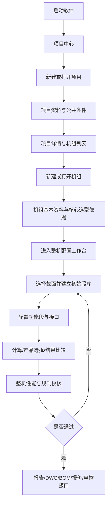
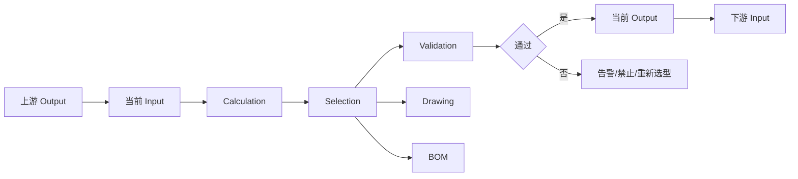

# 组合式空调机组选型软件技术规格书 V1.5

## 0. 文档控制

### 0.1 文档目的

本文是 P001 组合式空调机组选型软件的唯一总体技术规格书，统一描述产品范围、业务流程、界面信息架构、数据模型、计算与选型接口、图形输出、权限审计、迁移规则、阶段计划及验收标准。

本文合并并吸收以下来源：

- 原《组合式空调机组选型软件技术规格书》V1.0～V1.3；
- 《AHU_选型软件_现有界面改造需求说明_Codex.md》；
- 已确认的 P001 模块边界和数据迁移规则。

来源文档继续保留用于追溯，但后续产品和开发决策以本规格书为准。来源文档中的执行性措辞仅作为历史需求，不作为跳过评审、测试或项目边界的授权。

### 0.2 修订记录

| 版本 | 日期 | 修订内容 | 状态 |
|---|---|---|---|
| V1.0 | 2026-08-25 | 建立模块化选型软件总体需求、数据架构、选型流程和 Phase 1 规划 | 历史基线 |
| V1.1 | 2026-09-04 | 明确用户→项目→多台机组→功能段层级，以及继承、覆盖、审计和原型边界 | 历史基线 |
| V1.2 | 2026-09-04 | 明确风量、新风比、机外余压为机组级参数，取消项目模板默认值 | 历史基线 |
| V1.3 | 2026-09-04 | 项目页移除冷热源类型选择，只维护实际设计条件 | 历史基线 |
| V1.4 | 2026-09-04 | 合并现有界面改造需求；按业务、界面、数据、计算、输出、迁移和验收重新编排 | 历史基线 |
| V1.5 | 2026-09-05 | 基于主流 AHU 选型软件调研重构产品主链；取消静态原型登录页，建立项目中心、轻量机组创建和单屏配置工作台 | 当前 |

### 0.3 规范用语

- **必须/不得**：强制要求，验收失败即不通过。
- **应/建议**：目标要求；若不采用，需记录原因和替代方案。
- **预留**：数据结构和接口必须存在，但当前阶段可不实现完整算法。
- **项目条件**：项目下多台机组可共同引用的条件。
- **机组条件**：单台机组独立维护的数据，不由项目条件静默覆盖。

### 0.4 核心原则

> 同一参数只在合理的位置录入一次；上下游自动传递；每个功能段有清晰输入和输出；人工选型与自动选型使用同一数据结构；后续增加算法时不得推翻已有项目、机组、功能段、图纸和数据库结构。

---

## 1. 产品范围与建设目标

### 1.1 产品目标

建设一套面向组合式空调机组（AHU）的模块化选型软件，实现：

`项目条件 → 机组创建 → 空气处理 → 截面选择 → 功能段组合 → 单段计算/选型 → 整机校核 → 图形与成果输出`

软件支持标准和非标机组，允许人工干预，并按 L1 手工选型、L2 辅助选型、L3 自动选型逐级升级。

### 1.2 主要能力

1. 项目、机组和功能段分层管理；
2. 项目条件一次录入、机组继承、逐项覆盖和恢复；
3. 机组基本资料、设计输入、限制条件和段序模板创建；
4. 箱体截面矩阵推荐与手工非标截面；
5. 功能段增删、排序、复制、启停及统一编辑；
6. 单段和整机的规则、警告、禁止项与重算状态；
7. 参数化展示图和工程图数据底座；
8. 报告、技术参数、DWG、BOM、报价和电控接口；
9. 产品库、规则库、模板库、图形库及审计数据分离。

### 1.3 当前范围边界

- 当前静态页面和本地存储仅用于交互与数据模型验证；原型启动后直接进入项目中心，以本地工程师身份记录操作，不提供无实际安全能力的假登录页；
- 尚未确认的空气状态算法、盘管性能、风机曲线、功能段阻力、CAD、BOM 和报价不得伪造为正式结果；
- 未达到 L3 的功能段允许手工录入结果，但仍必须使用统一接口和校核结构；
- 正式认证、多人并发、事务数据库、服务端审计和备份恢复属于正式部署能力。

---

## 2. 业务层级与端到端流程

### 2.1 业务层级

```text
用户 / 角色
└─ 项目 Project
   ├─ 项目条件 ProjectCondition
   ├─ 气象引用 WeatherReference
   └─ 机组 Unit（0..n；项目可先独立建立）
      ├─ 机组设计条件 UnitDesignCondition
      ├─ 截面与安装限制 Cabinet / InstallationLimits
      ├─ 空气处理计算链 AirStateChain
      └─ 功能段 FunctionSection（1..n）
```

项目和机组不得合并为同一条扁平记录；项目名称、机组编号或数组下标不得作为稳定主键。

### 2.2 总体业务流程



流程必须允许返回修改。设计条件、截面、段序或选型结果变化时，只重算受影响对象，并显示影响范围和待重算状态。

### 2.3 主流产品调研与架构依据

本次调研只采用厂商官方产品页和官方资料。共同模式如下：

| 产品 | 官方能力摘要 | 对本项目的架构启示 |
|---|---|---|
| SystemairCAD | 从设计构想到最终 AHU 文档；选择机组尺寸、添加功能并点击符号配置；一个项目可维护多台机组 | 项目是容器，图形化功能链是主配置面，部件属性贴近选中对象 |
| Swegon AHU Design | Web 端完成机组尺寸、配置和能耗计算；项目包含多个选型；支持共享、报告、CAD 和控制系统资料 | 选型、性能、控制和成果输出属于同一条连续工作流 |
| FläktGroup ACON | 围绕项目要求管理机型、地点、热回收和控制；提供能耗/LCC、尺寸、AHU 文档及 BIM/CAD | 项目条件驱动整机配置，结果与工程交付物同屏可达 |
| Trane Select Assist / TOPSS | 以容量、效率和应用要求为输入，通过引导步骤给出满足要求的产品列表及技术资料 | 向导应只收集决定候选集的关键依据，候选结果应可比较 |
| Daikin ASTRA | 先输入系列、风量和冬夏工况得到即时 3D 初始结果，再定制部件并生成报告、价格和风机曲线 | 创建入口应短，截面、部件、性能和输出应在后续配置环境中持续联动 |

官方参考：

- <https://www.systemair.com/en-gb/contact-support/downloads/software-applications/systemaircad>
- <https://www.swegon.com/support/software/ahu-design/>
- <https://www.flaktgroup.com/es/soporte/product-selection-tools/>
- <https://www.trane.com/commercial/north-america/us/en/products-systems/design-and-analysis-tools/trane-select-assist.html>
- <https://www.trane.com/commercial/latin-america/ar/es/resources/topps-equipment-selection.html>
- <https://www.daikin.eu/en_us/product-group/air-handling-units.html>

由上述共性确定 P001 的产品架构：**项目中心负责组织，机组创建只收集关键依据，配置工作台负责截面、段序、部件、计算、校核和结果，成果中心负责工程交付。** 不按参考软件逐像素仿制，也不复制其专有算法和数据库。

### 2.4 关键状态

| 对象 | 建议状态 |
|---|---|
| 项目 | 草稿、编辑中、待审核、已完成、已归档 |
| 机组 | 草稿、待选型、待重算、校核警告、校核禁止、已通过 |
| 功能段 | 未配置、手工选型、辅助选型、自动选型、已覆盖、警告、禁止 |

---

## 3. 信息架构与导航

### 3.1 页面层级

1. 项目中心；
2. 项目新建/编辑；
3. 项目详情与机组列表；
4. 轻量机组创建；
5. 组合机组配置工作台；
6. 报告、图纸、BOM 和成果输出。

禁止把项目创建与单台机组创建混成一个页面。用户必须能够识别“用户 → 项目 → 机组 → 功能段”当前位置。

### 3.2 全局导航

组合机组工作台采用稳定的单屏工程布局：

- 顶部命令栏：项目/机组面包屑、切换机组、保存、计算、整机校核和成果输出；
- 左侧导航与资源区：机组树、设计任务以及按类别组织的功能段库；
- 中央配置区：机组段序画布、气流方向、截面/尺寸、候选结果和性能摘要；
- 右侧属性区：随当前机组或功能段切换的输入、计算、选型、结构、接口和校核；
- 底部状态栏：W×H×L、总阻力、计算版本、待重算和整机状态；
- 常驻“返回项目中心”“项目信息”“新建机组”入口。

桌面首屏不得依赖整页纵向滚动完成主要选型动作。编辑对象、属性和校核结果必须保持邻近，避免在页面上下来回查找。

---

## 4. 项目管理与项目条件

### 4.1 项目管理

项目管理页支持新建、查询、打开、编辑、复制和归档。列表至少显示项目名称、项目编号、地点、客户、业务承办人、技术支持、机组数量、状态和更新时间。查询至少覆盖这些字段，且不得改变业务数据。

### 4.2 项目基本资料

| 字段 | 要求 |
|---|---|
| 项目 ID | 系统生成、稳定、不可用名称替代 |
| 项目名称 | 必填 |
| 项目编号/登录号 | 建议填写 |
| 创建日期 | 默认当天，可审计修改 |
| 客户名称 | 可选 |
| 业务承办人 | 必填，正式版保存 userId 与显示名快照 |
| 设计人/技术支持 | 必填 |
| 项目地名称 | 必填，自由文本 |
| 工程地址、联系方式 | 可选，按权限保护 |
| 气象地区 | 独立关联 WeatherRecord |
| 海拔高度 | 可由气象记录带出，也可按权限覆盖 |

项目页不得录入机组编号、机组数量、箱体宽高、尺寸限制、段序、风量、新风量/新风比或机外余压。

### 4.3 气象记录与项目有效工况

WeatherRecord 可保留海拔、大气压、干球、湿球、相对湿度、焓值和含湿量等完整来源字段。项目有效室外工况只保存：冬季空调计算干球、冬季空调计算相对湿度、夏季空调计算干球、夏季空调计算湿球。

夏季相对湿度、焓值和含湿量可由状态计算得到或作为气象库只读信息显示，不得替代四项有效工况，也不得重复人工输入。项目保存气象记录 ID、数据库版本、来源、引用时间和数值快照。气象库变化时必须显示新旧值和影响范围，经确认后更新。

### 4.4 项目公共条件

项目至少维护室内设计干球/相对湿度、冷水和热水进回水温度、介质信息，以及室内/室外型、防护等级和安装环境等公共默认。

项目页不维护“冷热源类型（兼容）/冷源类型/热源类型”选择。直膨、冷水等类型由机组创建或对应专业段维护。

### 4.5 机组专属条件

以下字段只属于 Unit，不得作为 Project 模板值传播：

- 送风、新风、新风比、回风、排风、二次回风；
- 送风及回/排风机外余压；
- 箱体截面和运输/安装尺寸限制；
- 机组类型、产品名称、客户机组编号和段序；
- 能力需求、接口方向和推荐选型参数。

公共/个人模板只用于建立初始功能段序及明确允许的段参数，不得成为项目级风量、新风比或余压模板。

---

## 5. 机组创建与初始配置

机组创建是“建立可配置对象”的轻量入口，不等于完成截面选择、功能段编排或产品选型。创建过程最多使用两步，提交后立即进入整机配置工作台；复杂限制、截面候选、段序模板和部件参数在工作台中继续配置。

### 5.1 第一步：机组身份与产品边界

| 字段 | 要求 |
|---|---|
| 机组 ID | 系统生成稳定 ID |
| 设备编号/机组方案号 | 必填、项目内唯一 |
| 客户机组编号/位号 | 可选 |
| 数量 | 1～20；批量创建生成独立 unitId 和编号 |
| 产品名称 | 组合式、新风、热回收等 |
| 机组类型 | 卧式、立式、转轮热回收、板式热回收等 |
| 使用季节 | 夏季、冬季、冬夏季 |
| 冷源形式 | 冷水、直膨、无制冷盘管等 |
| 安装位置 | 室内、室外 |
| 气流方向 | 左进右出、右进左出、自定义 |
| 接管方向 | 左式、右式、自定义 |
| 面板 | 型式、厚度、内外板材质和厚度 |
| 电源 | 默认 AC380V/3Ph/50Hz，可修改 |

### 5.2 第二步：核心选型依据

- 送风量、新风量、新风比（新风量与新风比联动，指定一个主输入）；
- 回风量、排风量、二次回风量；
- 送风机、回/排风机选型方式及外余压；
- 夏/冬室外和室内状态点；
- 冷水、热水供回水温度；
- 直膨机组的冷媒类型、蒸发和冷凝工况；
- 制冷、制热、电加热、再冷、再热和加湿需求。

创建页可从项目条件预填公共工况。用户修改项目引用字段时，应形成机组级覆盖而不是改写 Project。

### 5.3 工作台内的限制条件

- 最大机组宽度、高度和总长度；
- 最大单段长度和检修空间；
- 运输分段最大宽、高、长及最大重量预留；
- 电源、噪声和迎面风速限制；
- 指定品牌、材料和特殊要求。

第一阶段未参与自动计算的限制仍必须保存，并可被后续规则调用。

### 5.4 工作台内的截面选择

继续使用 W×H 矩阵：

1. 根据送风量与有效面积计算迎面风速；
2. 按规则着色并突出推荐截面；
3. 超过宽高限制的候选自动禁用或显示禁止；
4. 实时显示宽、高、面积和风速；
5. 支持手工输入非标准截面；
6. 确认后写入机组主数据。

默认色带可采用 `v≤2.7` 绿色、`2.7<v≤3.0` 黄色、`3.0<v≤3.5` 橙色、`v>3.5` 红色，最终阈值必须来自规则库。

截面对象至少包含 `section_width_mm`、`section_height_mm`、`section_area_m2`、`face_velocity_mps`、标准/非标标识、来源和更新时间。

### 5.5 工作台内的模板与段序

用户可选择公共模板、个人模板、空白机组或从已有机组复制。模板只是建立初始段序的入口；创建后必须允许增加、删除、复制、前移、后移、拖拽排序和启停。

### 5.6 创建提交规则

- 提交前校验必填项、编号唯一性和批量编号冲突；
- 批量创建必须原子提交，失败不得产生部分机组；
- 创建成功后写审计、激活机组并进入工作台；
- 取消不得改变当前项目和已有机组。

---

## 6. 组合机组工作台

### 6.1 工作台首屏

工作台不是字段总览长表，而是围绕当前选择对象组织的工程配置环境：

1. 左侧机组树显示当前项目的全部机组、状态和切换入口；
2. 左侧功能段库按气流、过滤、冷热、湿度、风机、热回收和辅助分类；
3. 中央优先显示段序画布、气流方向、截面尺寸和选中对象；
4. 中央结果区显示候选、性能摘要与比较状态；
5. 右侧属性区只显示当前机组或功能段相关字段，并提供输入/计算/选型/结构/接口/校核页签；
6. 项目公共工况以只读引用和“覆盖”入口出现，不重复堆叠录入；
7. 任何改变候选集或计算结果的字段均触发待重算状态；
8. 宽高长、阻力、版本和整机状态常驻底部。

候选结果未计算时必须明确显示“尚未执行专业选型”，不得用默认值伪装正式结果。

### 6.2 功能段库与操作

功能段库至少包括：

- 进风/混风：新风、回风、混合、风阀；
- 过滤净化：初效、中效、高效、活性炭、静电、杀菌；
- 冷热处理：冷水/热水/钢管盘管、直膨、预热、电加热、再热；
- 湿度：蒸汽、电极/电热、湿膜、微雾、喷淋、转轮除湿；
- 风机：送风、回风、排风、风机阵列；
- 热回收：板式、转轮、热管；
- 气流与辅助：均流、静压、挡水、消声、检修、空段、送风。

工作台提供新增、修改、保存、前移、后移、复制、删除、启停、批量选型、一键配置、一键计算、报告和图纸入口。

### 6.3 组合画布

画布必须显示气流方向、功能段编号/名称/顺序、各段长度、总长、箱体宽高、段内符号、接管/检修门/接口位置，以及选中、警告、禁止和停用状态。

画布支持选中、拖拽排序、插入、删除、复制、缩放、平移和适配视图。段序变化后，图面、总长、阻力、BOM 和相关选型状态必须同步失效或重算。

### 6.4 属性与状态区

- 左侧：机组树、任务导航和功能段库；
- 右侧参数区：输入、计算、选型、结构、接口、校核、图形、BOM；
- 底部：W×H×L、总阻力、计算版本和整机状态。

---

## 7. 功能段统一模型与编辑模板

### 7.1 标准模型

```yaml
section_id: UUID
section_type: cooling_coil
section_name: 冷水盘管段
sequence: 4
enabled: true
geometry:
  length_mm: 700
  width_mm: 3200
  height_mm: 1770
input: {}
calculation: {}
selection:
  level: L1|L2|L3
  model: ""
  system_recommended: ""
  source: manual|database|calculation
output: {}
interfaces: []
validation:
  status: normal|warning|error
  messages: []
drawing:
  symbol_id: coil_chilled_water_v1
  view: side
  scale_mode: fit
bom: []
metadata:
  calculation_mode: manual|auto|mixed
  manually_overridden: false
  updated_by: user_id
  updated_at: ISO-8601
```

现有七段式 `Input → Calculation → Selection → Output → Validation → Drawing → BOM` 接口继续保留；向目标模型迁移时必须确定性映射，不得丢字段。

### 7.2 数据规则

1. 输入来自用户、项目/机组条件或上游输出，本段不得随意改写；
2. Calculation 只保存中间计算量；
3. Selection 保存理论推荐、实际选择、型号和来源；
4. Output 是报告和下游真正调用的数据；
5. 自动结果允许授权人工覆盖，但须保留推荐值、覆盖值、人员、时间和原因；
6. 数据库存储使用统一工程单位，UI 可转换显示；
7. 字段 ID 使用稳定英文代码，中文只用于显示。

### 7.3 编辑界面

所有功能段使用同一骨架：

`基本参数 | 输入参数 | 计算结果 | 选型结果 | 接口 | 结构尺寸 | 校核 | 图形 | BOM`

基本参数至少包括段 ID、类型、名称、顺序、启用状态、能力等级和计算模式。界面显示单位、来源、有效值、覆盖状态和更新时间。

### 7.4 上下游传递



同一状态参数不得在多个段重复手工录入。

---

## 8. 空气处理、截面与专业选型架构

### 8.1 两条链分离

空气处理计算链描述干球、湿度、含湿量、焓值、冷热量、加湿和除湿；实体结构链描述真实箱体段、长度、阻力、结构、图纸和 BOM。检修、空段、均流和消声段即使不改变空气状态，也必须存在于实体链。

### 8.2 三级能力

| 等级 | 定义 |
|---|---|
| L1 | 用户录入规格/型号，系统保存、传递、基础校核和出图 |
| L2 | 系统计算并给出若干可用方案，用户确认 |
| L3 | 依据条件、产品库、规则库和限制自动推荐 |

### 8.3 截面控制逻辑

候选截面不能只使用统一风速：各功能段分别给出允许面积，系统识别控制性功能段，匹配标准箱体模数，再用安装限制过滤。截面变化必须使盘管、过滤器、风机、阻力和图面等相关结果进入待重算。

### 8.4 风机选型顺序

`功能段阻力 + 箱体/局部阻力 + 机外余压 → 所需压力`

`设计风量 + 所需压力 → 风机工作点 → 效率 → 电机功率 → 噪声`

主要功能段或阻力变化后必须提示风机重新校核。

### 8.5 一键操作定义

- **一键配置**：建立建议段序，不等于完成专业选型；
- **一键计算**：计算空气状态、负荷、截面、阻力和已有算法段，列出未实现项；
- **批量选型**：按段序调用可用模块，失败段不得静默跳过；
- 每次操作生成受影响对象、失败原因、汇总结果和计算版本。

---

## 9. 规则、校核与重算

### 9.1 校核等级

- **正常**：满足推荐和强制边界；
- **警告**：工程上允许但超出推荐，需要确认；
- **禁止**：违反安全、产品或强制边界，不允许最终通过。

### 9.2 规则库

迎面风速、过滤器终阻力、最小检修距离、电加热分档、段序组合、箱体模数、运输限制和材料适用性等规则应配置化，并记录版本、适用产品、边界、等级、文本和生效日期。

### 9.3 重算与失效

项目条件传播、机组覆盖、截面变化、段序变化或人工覆盖后，相关机组/段标记 `pendingRecalculation`。完成对应计算和校核前不得显示最终通过。告警应定位字段或功能段，并提供原因、建议和处理状态。

---

## 10. 参数化图形与成果输出

### 10.1 图形对象

每个功能段至少预留图形 ID、宽高长、气流方向、检修方向、检修门、接口位置、符号、视图和缩放模式。

- 展示层：工作台和方案展示；
- 工程层：规范参数化图块，用于二维工程图和 CAD。

两层共享同一 sectionId 和业务参数。

### 10.2 第一阶段图块

优先规范新风/回风、混合、过滤、盘管、电加热、加湿、风机、热回收、消声、检修、空段和送风段。图块按段长拼接，并表达气流、接口和检修方向。

### 10.3 输出成果

- 机组技术参数表、选型结果和空气处理过程；
- 功能段配置、参数表和接口清单；
- 整机性能和二维示意图；
- DWG/CAD、技术规格书、BOM 和报价；
- 电控配置、I/O 点表和控制逻辑接口。

输出必须带项目/机组 ID、版本、生成时间、数据来源、人工覆盖和未完成项说明。

---

## 11. 数据、版本、继承与审计

### 11.1 核心实体

`User/Auth、Project、WeatherRecord、ProjectCondition、Unit、UnitDesignCondition、ConditionOverride、FunctionSection、Product、Rule、Template、DrawingAsset、BOM、AuditLog`

产品库、规则库、模板库、图形库、BOM 库和项目运行数据必须分离。

### 11.2 标识与版本

- `projectId`、`unitId`、`sectionId` 为稳定 ID；
- `schemaVersion` 表示 JSON 数据结构版本；
- `documentVersion` 表示业务规格书版本；
- 计算结果使用 `calculationRevision/resultRevision`；
- 三类版本不得混用。

### 11.3 参数元数据

关键参数至少保存：

`code、value、unit、source、defaultValue、required、editable、range、inheritMode、projectValue、effectiveValue、overrideValue、projectVersion、updatedBy、updatedAt`

### 11.4 继承与覆盖

新建机组默认引用项目公共条件。授权用户可逐项覆盖，系统保留项目值与机组值，并提供恢复项目值。项目条件变化时：

- 继承字段展示影响范围，经确认后传播；
- 已覆盖字段保留机组值，同时更新项目对比值；
- 传播后标记待重算并写审计；
- 风量、新风比、余压和箱体限制始终为机组专属，不参与项目传播。

### 11.5 审计与原子性

会话建立、项目编辑、机组创建、条件覆盖/恢复/传播、计算、选型、导入导出和归档均写审计。写入应先完整校验再原子提交；失败不留半成品；重复幂等操作不产生重复实体或审计。

---

## 12. 权限、安全与非功能要求

### 12.1 角色能力

| 角色 | 能力 |
|---|---|
| 普通用户 | 使用标准值和模板完成常规选型 |
| 高级用户 | 修改项目条件、机组覆盖和部分人工结果 |
| 管理员/专业人员 | 维护产品库、规则库、模板、图形和边界 |

项目查看、编辑、机组编辑、数据库维护、规则维护和成果发布分别授权。前端隐藏按钮不能替代后端权限。

### 12.2 正式安全边界

当前单机原型无需登录，启动时建立 `local-engineer` 本地会话并直接进入项目中心。正式版如启用多用户，认证、密码哈希、会话、失败限制、授权、审计、并发控制和备份恢复必须由服务端实现；密码不得写入项目文件或明文浏览器存储。单机原型通过不代表正式安全验收。

### 12.3 非功能要求

- 项目保存/读取不得丢失层级、来源、覆盖和版本；
- 错误应说明对象、原因和建议，不暴露敏感实现细节；
- 长列表、画布和数据库维护支持搜索、滚动和大数据量响应；
- 单位、数值精度和显示格式统一；
- 关键计算具备可重复测试和版本追踪；
- 导入失败不得替换当前项目。

---

## 13. 兼容与迁移

### 13.1 V1→V2 映射

| V1 字段/对象 | V2 目标 | 规则 |
|---|---|---|
| `project.name` | `Project.name` | 保留原值 |
| `project.unitNo` | `Unit.unitNo` | 移入首台机组 |
| 公共 `designConditions` | `Project.conditions` | 迁移为项目默认 |
| 风量/新风比/余压 | `Unit.designConditions` | 迁移为首台机组专属，不进入 Project 模板 |
| `cabinetWidth/Height` | `Unit.cabinet` | 迁移为首台机组截面 |
| `maxWidth/maxHeight` | `Unit.installationLimits` | 迁移为机组限制 |
| `outdoorLocation` | `Project.weatherReference` | 地点文本与气象引用分离 |
| 旧 `outdoorDryBulb` | 对应季节干球 | 无季节标识时阻断并待确认 |
| `segments` | `Unit.sections[]` | 保留顺序、ID、启停、段长和接口 |
| `selection` | `FunctionSection.selection` | 保留推荐、人工值、型号和来源 |
| `validation` | Project/Unit/Section validation | 按归属拆分 |
| `audit` | `AuditLog[]` | 保留用户、对象、时间和新旧值 |

迁移必须确定性、幂等、可回退并产生日志；不得用当前时间或默认值造成同一源文件重复迁移结果不同。

### 13.2 旧项目兼容

新增可选字段通过明确默认值补齐。未知 schemaVersion、缺失关键层级或无法判定的季节字段必须阻断导入并提示，不得静默猜测。

---

## 14. 开发阶段与文档模块化

### 14.1 阶段规划

| 阶段 | 目标 |
|---|---|
| Phase 1 骨架与规范 | 直接进入项目中心、项目/机组、条件继承、段链、L1/L2、基础校核、示意图、保存读取 |
| Phase 2 核心自动选型 | 空气状态、截面、过滤器、盘管、风机、电加热 |
| Phase 3 完整专业选型 | 热回收、加湿、除湿、恒温恒湿、复杂方案和整机优化 |
| Phase 4 成果自动化 | CAD、技术规格书、BOM、报价、电控、I/O 和企业系统接口 |

### 14.2 子规格书架构

详细算法不继续堆入总体规格书，按以下目录拆分：

```text
src/00-项目资料/spec/
├─ 00_规格书索引与需求追踪.md
├─ 01_本地会话权限与审计.md
├─ 02_项目管理与项目条件.md
├─ 03_机组创建与条件继承.md
├─ 04_空气状态计算.md
├─ 05_箱体截面选型.md
├─ 06_过滤器选型.md
├─ 07_盘管选型.md
├─ 08_风机选型.md
├─ 09_电加热选型.md
├─ 10_加湿与除湿选型.md
├─ 11_热回收选型.md
├─ 12_整机阻力与性能.md
├─ 13_规则与校核.md
├─ 14_参数化图形.md
├─ 15_CAD与成果输出.md
├─ 16_BOM报价与企业接口.md
└─ 17_电控及控制逻辑.md
```

子规格书统一采用：

`目的 → 范围 → 输入 → 来源 → 算法 → 产品选择 → 输出 → 上下游接口 → 校核 → 人工覆盖 → 图形 → BOM → 测试用例 → 验收编号`

---

## 15. 验收要求

### 15.1 SESSION 本地会话与正式认证边界

- `SESSION-01` 单机原型启动后直接进入项目中心，不显示登录页或要求空用户名密码。
- `SESSION-02` 原型使用固定本地用户标识和显示名写审计，不把本地会话宣称为正式认证。
- `SESSION-03` 人员字段保存 userId 和操作时显示名快照。
- `SESSION-04` 将来启用多用户时，认证与授权必须由服务端实现，不能恢复为纯前端假登录。

### 15.2 PM 项目管理

- `PM-01` 支持新建、查询、打开、编辑、复制和归档。
- `PM-02` 列表显示项目、地点、人员、状态和机组数量。
- `PM-03` 一个项目维护多台机组，归档不得删除历史。
- `PM-04` 项目上下文可新建或打开指定机组。
- `PM-05` 查询不得修改数据。

### 15.3 LOC 地点与气象

- `LOC-01` 项目地自由文本与气象记录分离。
- `LOC-02` 气象引用保存 ID、版本、来源、时间和快照。
- `LOC-03` 项目有效室外工况严格为冬干球/冬 RH/夏干球/夏湿球。
- `LOC-04` 气象库更新必须提示并确认传播。

### 15.4 COND 条件边界

- `COND-01` 项目页维护室内工况、冷热水温度和通用环境，不维护冷热源类型选择。
- `COND-02` 项目页不得出现机组编号、箱体和安装尺寸限制。
- `COND-03` 风量、新风比和余压只能在机组维护。
- `COND-04` 不提供项目级风量、新风比或余压模板。
- `COND-05` 公共条件只录入一次并支持受控继承。

### 15.5 UNIT 机组创建

- `UNIT-01` 只能从已建立项目上下文创建机组。
- `UNIT-02` 设备编号项目内唯一，批量创建原子提交。
- `UNIT-03` 创建入口最多两步，仅覆盖基本资料和决定初始候选的核心输入；限制、截面和模板/段序在工作台继续配置。
- `UNIT-04` 每台机组具有稳定 unitId 和独立条件、截面、段链及校核状态。
- `UNIT-05` 模板创建后仍可自由调整功能段。

### 15.6 SECTION 截面

- `SECTION-01` 矩阵实时显示宽、高、面积和迎面风速。
- `SECTION-02` 超安装限制候选禁用或禁止。
- `SECTION-03` 支持推荐、标准和手工非标截面。
- `SECTION-04` 截面确认写入 Unit 主数据并触发依赖重算。

### 15.7 FUNC 功能段

- `FUNC-01` 使用统一七段式接口和稳定 sectionId。
- `FUNC-02` 支持增加、删除、排序、复制和启停。
- `FUNC-03` 编辑界面区分输入、计算、选择、输出、接口、校核、图形和 BOM。
- `FUNC-04` L1/L2/L3 共用数据结构，人工覆盖可追踪。
- `FUNC-05` 上游输出自动传入下游，避免重复录入。

### 15.8 VAL 校核与重算

- `VAL-01` 校核区分正常、警告和禁止。
- `VAL-02` 告警定位对象和字段并给出原因。
- `VAL-03` 变更后受影响结果进入待重算。
- `VAL-04` 未完成项不得被一键计算或批量选型静默跳过。

### 15.9 DRAW/OUT 图形与输出

- `DRAW-01` 图形显示段序、尺寸、气流和接口。
- `DRAW-02` 展示层与工程层共享业务 ID。
- `DRAW-03` 段序或尺寸变化同步更新图面和总长。
- `OUT-01` 输出保留版本、来源、覆盖和未完成说明。
- `OUT-02` 报告、DWG、BOM、报价和电控接口不得使用伪造结果。

### 15.10 MIG/DATA/SECURITY

- `MIG-01` 项目条件支持继承、覆盖、恢复和确认传播。
- `MIG-02` 风量、余压和尺寸始终保持机组专属。
- `MIG-03` V1→V2 迁移确定性、幂等、可回退。
- `DATA-01` 项目→机组→功能段关系在保存和导入导出中完整保留。
- `DATA-02` 关键修改写审计，写入失败不留半成品。
- `SECURITY-01` 正式权限在服务端执行，前端隐藏不能替代授权。
- `SECURITY-02` 静态原型通过不等于安全、并发或事务验收通过。

---

## 16. 当前实现偏差与待确认事项

### 16.1 已知实现偏差

1. 当前原型仍存在 `project.templates.airVolume/freshAirRatio/externalPressure`，与 V1.2～V1.5 的机组专属要求不一致；后续应迁移到 Unit，保留旧项目兼容映射。
2. 当前功能段接口以 `segment.interface` 聚合保存，与目标 FunctionSection 模型命名不同；需建立映射后渐进迁移。
3. 当前候选机组型号区仅为输入汇总和空结果状态，未连接完整截面、风机、盘管和整机性能算法。
4. 当前使用固定本地工程师会话；权限、项目索引和审计为浏览器原型，不具备正式服务端能力。
5. 当前工作台已建立“左侧资源—中央画布/结果—右侧属性—持续校核”的首版布局，但详细条件仍需逐步改为按选中对象切换的属性页签。

### 16.2 待确认业务数据

1. 产品系列和标准箱体模数；
2. 功能段标准尺寸和最小检修距离；
3. 各段推荐/最大迎面风速；
4. 空气处理方案判断规则；
5. 盘管算法或外部接口；
6. 风机品牌及曲线库；
7. 过滤器、加湿器、热回收器产品库；
8. CAD 图块和历史图纸复用方式；
9. BOM、ERP、报价和电控接口；
10. 正式组织、权限矩阵和部署方案。

---

## 附录 A：需求来源追踪

| 来源需求章节 | 本规格书章节 |
|---|---|
| 改造目标、总体流程 | 1、2 |
| 工程/机组管理与新建工程 | 3、4 |
| 机组模板选择 | 5.5 |
| 截面/箱体尺寸矩阵 | 5.4、8.3 |
| 机组创建界面改造 | 5 |
| 功能段统一数据模型 | 7 |
| 功能段编辑界面 | 7.3 |
| 图面改造与组合画布 | 6.3、10 |
| 输入输出传递 | 7.4、8 |
| 一键计算与批量选型 | 8.5 |
| 校核与警告 | 9 |
| 现有代码改造原则与兼容 | 11、13 |
| 建议项目目录与后续需求 | 14.2 |
| 待做清单 | 16.2 |
| 截图对应关系 | 3～6 |

## 附录 B：文档使用规则

1. 本文件维护总体业务边界、跨模块接口和验收编号；
2. 具体算法、产品数据和模块测试放入 `spec/` 子规格书；
3. 新需求必须关联至少一个验收编号；
4. 修改数据层级、字段归属或版本规则时，同步更新迁移章节；
5. 原始需求说明不删除、不覆盖，作为来源证据保留；
6. 本规格书通过不等于软件实现、测试、部署或 Git 归档完成，四者分别记录。
